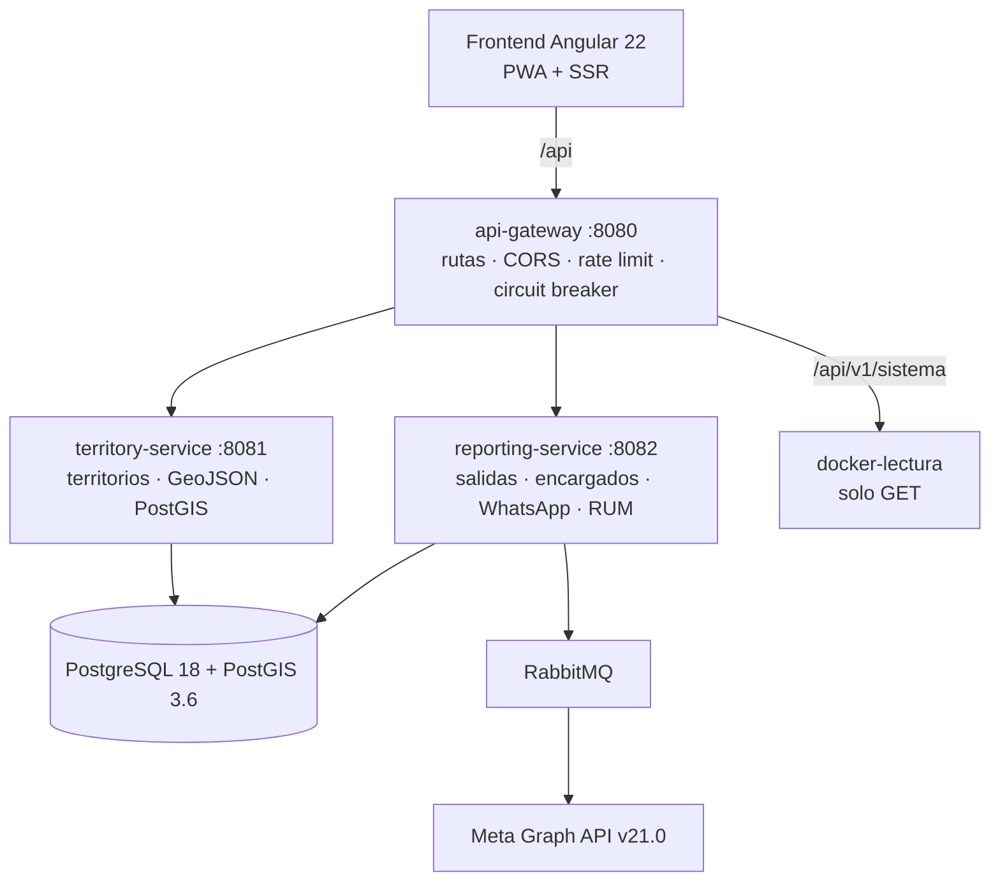

<div align="center">

# Predicador

**Gestión de territorios y reportes de predicación, en el mapa y en el teléfono.**

PWA para los Testigos de Jehová: marcar manzanas y calles, enviar el reporte por WhatsApp,
consultar el avance de cada territorio y administrar todo desde un panel.

[](https://openjdk.org/)
[](https://spring.io/projects/spring-boot)
[](https://angular.dev/)
[](https://postgis.net/)
[](LICENSE)

</div>

---

## ¿Qué es?

Predicador reemplaza el mapa de papel y el reporte por mensaje suelto con una sola aplicación:

- El **encargado** abre el mapa, marca lo que se predicó y envía un resumen por WhatsApp.
- El **administrador** ve el avance de todos los territorios, corrige errores, cierra ciclos y
  descarga el **S-13** en Word desde el panel.
- Cualquier hermano puede consultar el **visor público** sin iniciar sesión.

No se pierde historial: un territorio siempre vale por su **último reporte**. Corregir o anular
agrega un reporte nuevo; nunca se borra uno para cambiar el estado
([ADR 0011](docs/adr/0011-s13-ciclos-y-correcciones.md), [ADR 0014](docs/adr/0014-corregir-o-anular-una-salida.md)).

## Empezar rápido

### 1. Configurar el entorno

```bash
cp .env.example .env
```

Como mínimo, completa en `.env`:

```bash
DB_PASSWORD=...                 # openssl rand -hex 24
SESSION_SECRET=...              # openssl rand -hex 32
ADMIN_USERNAME=admin
ADMIN_PASSWORD_BCRYPT=...       # htpasswd -bnBC 10 "" 'tu-clave' | tr -d ':\n'
```

> `SESSION_SECRET` debe ser **el mismo** en gateway, territory y reporting, o los tokens no
> verifican entre servicios. Fuera del perfil `local`, `ADMIN_PASSWORD_BCRYPT` es obligatorio.

### 2. Levantar el backend

```bash
docker compose up --build
```

Quedan arriba PostgreSQL + PostGIS, RabbitMQ, los cinco servicios y el proxy de solo lectura
`docker-lectura`. El primer arranque importa la base desde Neon si defines `NEON_URL`.

### 3. Levantar el frontend

```bash
cd territory-frontend
corepack enable
pnpm install
pnpm start
```

Abre **http://localhost:4200**. El servidor de desarrollo hace proxy de `/api` hacia
`http://localhost:8080`.

| Pantalla | Ruta | Acceso |
|---|---|---|
| App de campo | `/map` | Encargado con perfil |
| Panel de administración | `/admin` | Administrador |
| Visor público | `/visor` | Sin sesión |
| Login | `/login` | — |

## Cómo está armado



El gateway es la única entrada HTTP. Sirve él mismo `/api/v1/auth/**` y `/api/v1/sistema/**`;
el resto lo enruta por Eureka (`lb://`) con circuit breaker y reintento solo en `GET`.

| Servicio | Puerto | Responsabilidad |
|---|---|---|
| `config-server` | 8888 | Configuración centralizada (Spring Cloud Config, `native`) |
| `discovery-server` | 8761 | Registro de servicios (Eureka) |
| `api-gateway` | 8080 | Entrada única, autenticación, rate limiting, «Sistema» |
| `territory-service` | 8081 | Territorios, manzanas, geometrías, colores |
| `reporting-service` | 8082 | Salidas, encargados, ciclos, WhatsApp, RUM |

El orden de arranque importa: `config-server` → `discovery-server` → `api-gateway` →
`territory-service` / `reporting-service`. Docker Compose lo garantiza con health checks.

## Funciones

### App de campo (`/map`)

- **Marcado por manzana**: un toque abre el territorio; otro marca la manzana y otro la desmarca.
  Tocar otro territorio pregunta si agregarlo a la salida.
- **Marcado por calles**: se elige una manzana y las calles predicadas; se marca una franja.
  Se puede retomar y editar después.
- **Lo ya reportado no se deshace**: las manzanas y calles de un reporte enviado quedan
  bloqueadas. Un error lo corrige el administrador desde el panel.
- **Nada se pierde sin preguntar**: cerrar con marcas sin enviar, cerrar sesión y enviar piden
  confirmación. «Enviar» solo se habilita si hay cambios desde el último reporte.
- **Día y turno**: se elige el día en que se predicó (hoy, ayer o hasta 7 días atrás) y el turno
  mañana/tarde ([ADR 0018](docs/adr/0018-dia-de-predicacion.md)).
- **Tutorial con práctica**: enseña sobre un territorio de ejemplo y solo avanza cuando la persona
  hace cada paso. Nada de la práctica se guarda.
- **Buscador**, **mi ubicación**, **colores por territorio**, **modo oscuro**, **PWA offline** y
  **borrador local**: lo marcado sin enviar sobrevive a recargas y caídas de conexión.
- **Envío por WhatsApp** al teléfono del encargado logueado, con captura del mapa. Un territorio
  completo se anuncia sin captura; los territorios ya completados se excluyen de la imagen.

### Visor público (`/visor`)

Mapa de solo lectura para quien no saca territorio o no dirige grupo: muestra qué manzanas y
calles se predicaron en la vuelta en curso, si el territorio está completo y cuándo se trabajó
por última vez. No expone nombres ni teléfonos.

### Panel de administración (`/admin`)

| Módulo | Qué permite |
|---|---|
| **Resumen** | Cobertura, manzanas trabajadas, territorios en curso, ranking por encargado, mapa de calor día × hora; exporta CSV |
| **Territorios** | Crear y editar manzanas, moverlas entre territorios, colores, importar/exportar GeoJSON, revisar y reparar geometrías |
| **Encargados** | Alta, edición, PIN, desbloqueo, fusión de duplicados y carga de una lista pegada desde Excel/CSV (con simulación previa) |
| **Reportes** | Listado con filtros, dobles envíos y estado de los WhatsApp; exporta CSV |
| **S-13 y ciclos** | S-13-S en Word por año de servicio, cierre de ciclo con informe, corrección de un territorio y cambio del día en que empezó el ciclo |
| **Registrar salida** | Guarda lo que un hermano informó por WhatsApp como una salida normal, de uno o varios territorios ([ADR 0021](docs/adr/0021-registrar-salidas-desde-el-panel.md)) |
| **Sistema** | Estado del VPS, contenedores y respaldos, en solo lectura y pidiendo la contraseña otra vez ([ADR 0020](docs/adr/0020-panel-sistema-solo-lectura.md)) |

## Stack

| Capa | Tecnologías |
|---|---|
| **Backend** | Java 25, Spring Boot 4.1.1, Spring Cloud 2025.1.3, Maven multi-módulo |
| **Gateway** | Spring Cloud Gateway (WebFlux), Resilience4j, Bucket4j |
| **Datos** | PostgreSQL 18 + PostGIS 3.6, Flyway, Hibernate Spatial, Caffeine |
| **Mensajería** | RabbitMQ 4.3.4, Meta Graph API v21.0 |
| **Frontend** | Angular 22 zoneless, TypeScript 6, Signals, SSR (Express 5), Service Worker |
| **Mapas** | MapLibre GL 6, terra-draw, `polygon-clipping` |
| **Testing** | JUnit 5 + Mockito + Testcontainers · Vitest + jsdom |
| **Infra** | Docker Compose, GitHub Actions, SonarCloud, OpenTelemetry |

## Comandos

### Frontend (`territory-frontend/`)

```bash
pnpm start                    # desarrollo en :4200 (proxy a :8080)
pnpm run build                # build de producción con SSR
pnpm test -- --run --coverage # tests + cobertura
pnpm run lint                 # ESLint + Prettier
pnpm run lint:fix             # corrige formato y lint
pnpm run serve:ssr:territory-frontend  # servidor SSR en :4000
```

> Solo `pnpm`: `package.json` fija `pnpm@9.15.0` y `pnpm-lock.yaml` es el único lockfile.

### Backend (`backend/`)

```bash
mvn clean install                          # compila todos los módulos
mvn verify -Pcoverage -B                   # tests + gate JaCoCo 40%
mvn -pl reporting-service test             # un módulo
mvn -pl api-gateway spring-boot:run        # un servicio
```

Los seis tests de integración con base de datos solo corren con Docker disponible:

```bash
TESTCONTAINERS_RYUK_DISABLED=true mvn verify -Pcoverage -B -Ddocker.available=true
```

> Sin ese entorno, `territory-service` queda bajo el gate de cobertura y el build falla en local.
> Es esperado, no una regresión. Detalle en [`docs/ai/testing/integration.md`](docs/ai/testing/integration.md).

### Docker

```bash
docker compose up --build                 # todo el backend
docker compose up -d                      # en segundo plano
docker compose down                       # detener
docker compose logs -f reporting-service  # logs de un servicio
docker compose --profile observability up -d  # Prometheus, Grafana, Jaeger y OTel
```

## API

Todas las rutas viven bajo `/api/v1` y se alcanzan por el gateway (`:8080`). La lista completa
está en [`docs/ai/api-reference/services.md`](docs/ai/api-reference/services.md).

| Método | Ruta | Acceso | Qué hace |
|---|---|---|---|
| `POST` | `/auth/login` | Público | Login del administrador |
| `POST` | `/encargados/login` | Público (6/min) | Login del encargado por teléfono (+ PIN) |
| `GET` | `/encargados/registro` | Público | Indica si el auto-registro está abierto |
| `GET` | `/territories/all/geojson` | Público | GeoJSON de todos los territorios |
| `GET` | `/territories/colors` | Público | Colores asignados |
| `POST` | `/reports` | Encargado | Registrar una salida |
| `POST` | `/reports/send` | Encargado | Enviar el resumen por WhatsApp |
| `GET` | `/reports/public/estado` | Público | Estado de cada territorio para el visor |
| `GET` | `/reports/admin` | Admin | Reportes de un rango |
| `POST` | `/reports/admin/ciclos/cerrar` | Admin | Cerrar ciclo y reiniciar territorios |
| `POST` | `/reports/admin/salidas` | Admin | Registrar una salida informada por WhatsApp |
| `GET` | `/territories/admin/calidad` | Admin | Geometrías inválidas y superposiciones |
| `GET` | `/sistema/estado` | Admin + pase | VPS, contenedores y respaldos (solo lectura) |
| `POST` | `/rum` | Público (30/min) | Ingesta de Core Web Vitals |

## Base de datos y respaldos

La base es PostgreSQL 18 + PostGIS 3.6 en el contenedor `postgres` del compose
([ADR 0006](docs/adr/0006-self-hosted-postgres-replaces-neon.md)). Las geometrías se guardan en
`manzanas_territorio` como `geometry(GeometryZ, 4326)`; `territory-service` las expone como GeoJSON
con `ST_AsGeoJSON(ST_Force2D(geometry))`, así que no hay parsing de WKB/WKT en Java.

### Migraciones (Flyway)

Cada servicio versiona sus migraciones en una tabla de historial propia:

| Servicio | Historial | Migraciones |
|---|---|---|
| `territory-service` | `flyway_schema_history_territory` | `V0`–`V2` |
| `reporting-service` | `flyway_schema_history_reporting` | `V0`–`V9` + `V1_1` |

Ambos usan `DB_URL_UNPOOLED` (conexión directa) para Flyway. Nunca se edita una migración
aplicada: se agrega una nueva.

### Respaldo

Un workflow diario entra al VPS por SSH, hace `pg_dump` y lo cifra con `age` **antes** de que el
archivo salga del servidor ([ADR 0012](docs/adr/0012-respaldo-bdd-fuera-del-vps.md)):

```bash
# Revisar un respaldo sin tocar producción
scripts/db/restaurar.sh predicador-AAAAMMDD-HHMMSS.dump.age ~/llave-privada.txt
# Emergencia o servidor nuevo
scripts/db/restaurar.sh predicador-AAAAMMDD-HHMMSS.dump.age ~/llave-privada.txt --reemplazar
```

La configuración completa (llave SSH, secrets, llaves de cifrado) está en
[`docs/ai/operations/backup.md`](docs/ai/operations/backup.md).

## Configuración

Todo se configura por variables de entorno. La lista completa está en `.env.example`.

| Variable | Para qué | Default |
|---|---|---|
| `DB_PASSWORD` | Contraseña de PostgreSQL | obligatoria |
| `DB_URL` | JDBC del servicio | `jdbc:postgresql://postgres:5432/predicador` |
| `DB_URL_UNPOOLED` | JDBC directa para Flyway | igual a `DB_URL` |
| `SESSION_SECRET` | Firma HMAC de los tokens (≥32 bytes) | obligatoria |
| `SESSION_TTL_HOURS` | Duración de la sesión | `12` |
| `ADMIN_USERNAME` | Usuario del administrador | `admin` |
| `ADMIN_PASSWORD_BCRYPT` | Clave del administrador (BCrypt) | obligatoria fuera de `local` |
| `SESSION_COOKIE_SECURE` / `CSRF_COOKIE_SECURE` | Cookies solo por HTTPS | `true` en compose |
| `CORS_ALLOWED_ORIGINS` | Origen permitido | `http://localhost:4200` |
| `EUREKA_CLIENT_SERVICE_URL_DEFAULTZONE` / `SPRING_CLOUD_CONFIG_URI` | Discovery y configuración | `http://localhost:8761/eureka/` / `http://localhost:8888` |
| `WHATSAPP_PHONE_ID` / `WHATSAPP_ACCESS_TOKEN` | Credenciales de Meta | — |
| `WHATSAPP_TEMPLATE` | Plantilla del mensaje | `asignacion_territorio` |
| `WHATSAPP_LANG` | Idioma de la plantilla | `es_CL` |
| `WHATSAPP_DEFAULT_IMAGE_URL` | Imagen al anunciar un territorio completo | — |
| `WHATSAPP_DESTINATION` | Destino de respaldo | — |
| `PORTAINER_URL` | Enlace «Abrir Portainer» del panel | — |
| `NEON_URL` | Importación inicial desde Neon | — |

## Seguridad

- **Tokens HMAC-SHA256** (no JWT): `base64url(subject|role|iat|exp).base64url(firma)`, con
  comparación en tiempo constante.
- **Contraseñas y PIN** con BCrypt; 5 intentos fallidos bloquean la cuenta 15 minutos.
- **Rate limiting por IP** con Bucket4j: login y «Sistema» 6/min, auto-registro 20/min, RUM 30/min.
- **Doble control de admin**: el gateway y cada servicio verifican el rol en `/admin/**`.
- **Módulo «Sistema»**: exige la contraseña de nuevo y un pase de 15 min de inactividad / 1 h
  máximo. Responde 403 (nunca 401) para no cerrar la sesión del panel.
- **Solo lectura sobre Docker**: `docker-lectura` permite únicamente listar contenedores y leer su
  consumo; el `inspect` expondría variables de entorno con contraseñas.
- **Cabeceras de seguridad**, CORS configurable y validación con ProblemDetail (RFC 7807).

## Observabilidad

Opt-in, sin costo cuando está apagada:

```bash
docker compose --profile observability up -d
```

| Servicio | Puerto | Uso |
|---|---|---|
| Prometheus | 9090 | Métricas y alertas |
| Grafana | 3000 | Dashboards (admin/admin) |
| Jaeger | 16686 | Trazas distribuidas |
| OTel Collector | 4317 / 4318 | Recolección de trazas |

El backend expone métricas HTTP, JVM, base de datos, WhatsApp y circuit breakers. El frontend envía
Core Web Vitals (LCP, INP, CLS, FCP, TTFB) por ruta a `POST /api/v1/rum`.

## Tests y CI

| Suite | Comando | Estado actual |
|---|---|---|
| Frontend | `pnpm test -- --run --coverage` | 399 tests, 51 archivos |
| Backend | `TESTCONTAINERS_RYUK_DISABLED=true mvn verify -Pcoverage -B -Ddocker.available=true` | 541 tests, 0 skipped |
| Lint | `pnpm run lint` | 0 errores |

Umbrales de cobertura del frontend: **60/58/55/50** (lines/statements/functions/branches).
Backend: gate JaCoCo de **40%** por módulo. Métricas al día en
[`docs/ai/metrics/`](docs/ai/metrics/).

CI en GitHub Actions:

| Workflow | Qué hace |
|---|---|
| `ci-backend.yml` | Build + tests con PostgreSQL/PostGIS y JaCoCo |
| `ci-frontend.yml` | `pnpm audit` → lint → build → tests con cobertura |
| `security.yml` | gitleaks, OWASP dependency-check, Trivy y Semgrep |
| `sonarcloud.yml` | Análisis SonarCloud con cobertura de ambos stacks |
| `docker.yml` | Construye y publica las imágenes en GHCR |
| `respaldo-bdd.yml` | Respaldo diario cifrado de la base |
| `opencode.yml` | Asistente de IA bajo demanda en issues y PRs |

## Documentación

| Documento | Contenido |
|---|---|
| [`AGENTS.md`](AGENTS.md) | Reglas del repo y gotchas verificados (fuente más actualizada) |
| [`docs/adr/`](docs/adr/) | Decisiones de arquitectura |
| [`docs/ai/`](docs/ai/README.md) | Paquete de apoyo para IA: arquitectura, API, pruebas, advertencias |
| [`CHANGES.md`](CHANGES.md) | Resumen de cambios en lenguaje llano |
| [`openspec/`](openspec/) | Flujo de trabajo SDD (`changes/`, `specs/`) |

## Estructura

```text
predicador-app/
├── backend/
│   ├── shared/                    # seguridad, excepciones y utilidades compartidas
│   ├── config-server/             # configuración centralizada
│   ├── discovery-server/          # Eureka
│   ├── api-gateway/               # rutas, auth, rate limit y módulo «Sistema»
│   ├── territory-service/         # territorios y geometrías
│   ├── reporting-service/         # salidas, encargados, ciclos y WhatsApp
│   └── pom.xml
├── territory-frontend/
│   └── src/app/
│       ├── core/                  # servicios, guards, interceptors, mapas base
│       └── features/              # auth, map, profile, visor, admin
├── docker-lectura/                # proxy HAProxy de solo lectura a Docker
├── observability/                 # Prometheus, Grafana, OTel
├── scripts/db/                    # respaldo, restauración y age
├── tests/                         # k6 y smoke test de trazas
├── docs/                          # ADRs y paquete de documentación AI
├── docker-compose.yml
└── .github/workflows/             # CI/CD
```

## Licencia

MIT.
